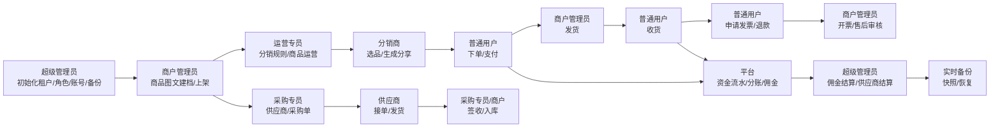

# 福礼社平台角色操作流程与协作设计（新系统初始化版）

> 适用范围：`frontend/admin`（管理端）、`frontend/pc`（PC 商城）、Mock API（`frontend/admin/mock-server.cjs`）
> 配套脚本：`frontend/admin/mock/simulate-lifecycle.cjs`（初始化 + 全链路模拟）
> 配套录屏：`docs/recordings/`（每个角色一段，文件名与操作一一对应）

---

## 1. 设计目标

把平台当作一套**全新上线**的系统，从零说明：

1. 系统如何初始化（租户、角色、账号、商品图文、供应链、营销、数据基线）；
2. 七类角色各自做什么、按什么顺序做、彼此交接什么；
3. 一条订单从建档到售后、分账、结算、备份的完整闭环；
4. 用什么方式持续验证（接口模拟 + 角色工作流录屏）。

---

## 2. 系统初始化

### 2.1 初始化顺序

| 顺序 | 初始化内容 | 责任角色 | 落地位置 |
| --- | --- | --- | --- |
| 1 | 平台租户、审核状态、有效期 | 超级管理员 | `seed.tenants`、租户管理页 |
| 2 | 角色、菜单、角色-菜单授权 | 超级管理员 | `seed.roles`、`seed.roleMenus`、`menuList` |
| 3 | 账号、所属租户/供应商/分销商绑定 | 超级管理员 | `seed.users` |
| 4 | 商户资料、联系人、经营地址 | 商户管理员 | `/merchant/profile` |
| 5 | 商品分类、品牌 | 商户管理员/平台 | `/product/category`、`/product/brand` |
| 6 | 商品 SPU、SKU、主图/图集/详情图文、库存 | 商户管理员 | `/product/spu` |
| 7 | 供应商、采购单、入库、库存台账 | 采购专员 + 供应商 | `/supply/*` |
| 8 | 满减促销、分销佣金规则 | 平台管理员 + 运营专员 | `/promotion/*`、`/distribution/rules` |
| 9 | 卡券模板/批次、发放 | 平台管理员 | `/coupon/*` |
| 10 | 数据基线快照（可恢复） | 超级管理员 | `/system/backup` |

### 2.2 商品图文数据结构

商品建档时一次性写入，前台列表/详情/分享卡片均复用同一份数据：

```json
{
  "spuName": "福礼社·新春坚果礼盒（模拟新品）",
  "categoryId": 3,
  "brandId": 2,
  "image": "主图 URL",
  "images": ["主图", "细节图", "场景图"],
  "detailSections": [
    { "title": "礼盒内容", "content": "夏威夷果、巴旦木、腰果……" },
    { "title": "交付说明", "content": "下单后 48 小时内发货……" }
  ],
  "tags": ["企业福利", "年货礼盒", "坚果"],
  "serviceTags": ["包邮", "7 天无理由", "可开票"],
  "sellPrice": 299,
  "costPrice": 150,
  "stock": 120
}
```

> 商品新增/修改/上下架后必须清理响应缓存（`perf.clearCache()`），否则前台与列表会出现脏数据。

### 2.3 初始化模拟脚本

```powershell
cd frontend/admin
node mock/simulate-lifecycle.cjs
```

脚本会**独立启动**一个 Mock 服务（随机端口，独立备份目录，不影响 8080 演示环境），按真实角色权限完成 10 个阶段、101 项断言，全部通过后自动关闭。

初始化种子规模（便于验收）：

- 租户 5 个、角色 7 个、账号 15 个
- 商品 32 个、SKU 42 个
- 订单 60 单、支付记录 51 条、退款 8 条、发票 3 张
- 采购单 18 张、库存台账 32 条、物流单 16 条、结算单 8 张
- 卡券模板 8 个、批次 8 个、卡券 30 张
- 链上区块 25 个、链上交易 75 笔

---

## 3. 角色清单

| 角色 | 演示账号 | 数据范围 | 默认入口 |
| --- | --- | --- | --- |
| 超级管理员 | `admin` | 全平台 | `/dashboard` |
| 商户管理员 | `fulishe_admin` | 本商户 | `/merchant/dashboard` |
| 采购专员 | `zhangsan` | 本商户供应链 | `/supply/purchase` |
| 供应商 | `supplier_fuli` | 本人供应商 | `/supply/purchase` |
| 运营专员 | `fulishe_operator` | 本商户商品/订单/分销 | `/product/spu` |
| 分销商 | `distributor_chen` | 本人推广数据 | `/distributor/selection` |
| 普通用户 | `user1` | 本人订单/卡券/发票 | PC 商城 `/home` |

> 所有演示账号密码均为 `123456`。供应商与分销商账号通过 `supplierId` / `distributorId` 绑定业务主体。

---

## 4. 端到端协作主流程



---

## 5. 各角色操作流程

### 5.1 超级管理员（admin）

**职责**：平台级配置、租户审核、权限授权、资金与结算兜底、数据安全。

操作步骤：

1. 登录 → 数据看板（平台 GMV、订单、商户、告警）。
2. 租户管理：新增租户 → 审核通过（未通过无法登录商户后台）。
3. 角色管理：调整角色菜单授权（即时影响后续权限计算）。
4. 用户管理：新增账号、绑定租户/供应商/分销商、重置密码、启停用。
5. 营销管理：发布满减规则（当前权限模型下由超管发布）。
6. 分销管理：查看分销商、推广订单，确认佣金结算。
7. 供应链对账：确认供应商结算单。
8. 数据备份：核对自动备份状态 → 需要时手动备份/恢复/删除。

关键接口：
`/api/user/tenant/*`、`/api/user/role/*`、`/api/user/menu/*`、`/api/admin/promotion/full-reduction`、`/api/distribution/orders/:id/settle`、`/api/supply/settlement/:id/settle`、`/api/admin/backup/*`

---

### 5.2 商户管理员（fulishe_admin）

**职责**：本商户经营全貌，商品、订单、支付、售后、发票、结算。

操作步骤：

1. 商户工作台：查看销售额、订单数、待发货、待退款、待结算。
2. 商户资料：维护联系人、电话、邮箱、地址。
3. 商品管理：新增商品（主图/图集/详情图文）→ 设置价格与库存 → 上架。
4. 订单管理：查看订单明细 → 对待发货订单发货（填写物流公司与单号）。
5. 支付/退款：查看支付记录；审核用户退款申请（通过后原路退回并回补库存）。
6. 发票管理：对已支付订单开具发票。
7. 供应链：审核采购单、签收入库、查看库存与结算。

状态约束：

- 订单仅支持 `待发货(1) → 已发货(2)`、`待支付/待发货 → 已取消(4)`。
- 退款审核通过后订单置为 `已退款(6)`，支付单 `payStatus=4`。
- 开票后订单仍可售后，但发票需按财务规则红冲，不可直接删除。

---

### 5.3 采购专员（zhangsan）

**职责**：供应商主数据、采购单、库存与物流协同。

操作步骤：

1. 供应商管理：新增/维护供应商（名称、联系人、品类、等级、信用分）。
2. 创建采购单：选择供应商与商品、数量、采购价、仓库、期望到货日。
3. 提交后由商户管理员审核（`0 → 1`）。
4. 供应商接单（`1 → 2`）并回传物流公司与单号。
5. 采购专员/商户签收，再执行入库（`2 → 3`），库存与商品库存同步增加。
6. 库存管理：查看可用库存、锁定库存、预警线，必要时手工调整。
7. 对账结算：查看供应商结算单，由平台完成打款确认。

状态机（不可跳级、不可回退）：

```text
0 待审核 → 1 待接单 → 2 待入库 → 3 已完成
```

幂等要求：同一采购单重复入库必须被拒绝（`stockedAt` 已存在）。

---

### 5.4 供应商（supplier_fuli）

**职责**：只处理绑定给自己的采购单与对账。

操作步骤：

1. 登录后进入采购订单，仅能看到 `supplierId` 与本人一致的采购单。
2. 接单（`1 → 2`），系统记录接单人/接单时间。
3. 发货：填写物流公司与物流单号（不改动采购状态机）。
4. 查看对账结算单与历史合作数据。

权限边界：供应商不能审核采购单、不能入库、不能查看其他供应商数据。

---

### 5.5 运营专员（fulishe_operator）

**职责**：商品与订单运营、分销规则、发票协同。

操作步骤：

1. 商品列表：筛选/查看本商户商品与状态。
2. 订单列表：跟踪订单流转，配合客服处理异常。
3. 分销管理：创建/停用佣金规则（一级/二级佣金率、T+N 结算周期）。
4. 推广订单：查看归因、佣金计提与结算状态。
5. 发票管理：查看待开票/已开票/已红冲。

权限说明：满减促销当前由超级管理员发布，运营可查看商品、订单、分销与发票数据。

---

### 5.6 分销商（distributor_chen）

**职责**：选品、生成分享链接、跟踪推广佣金。

操作步骤：

1. 选品中心：从有生效佣金规则的商品中加入选品。
2. 我的分享：为选品商品生成分享链接（`shareId`）。
3. 推广与佣金：查看订单归因、佣金金额、结算状态（PENDING / SETTLEABLE / SETTLED / INVALID）。
4. 用户通过分享链接下单并支付后，佣金按规则计提；订单完成且到达 T+N 后可结算；退款则佣金冲正。

合规约束：

- 仅二级分销，禁止自购归因、禁止成环、禁止三级。
- 一二级佣金率合计不超过 50%。

---

### 5.7 普通用户（user1，PC 商城）

**职责**：浏览、下单、支付、收货、开票、售后。

操作步骤：

1. 登录 PC 商城（`/login`）。
2. 首页/分类浏览 → 商品详情（主图、图集、详情图文、溯源）。
3. 加入购物车 → 去结算 → 确认收货地址 → 提交订单。
4. 收银台选择支付方式 → 确认支付。
5. 我的订单：查看物流、确认收货。
6. 申请开票（个人/企业抬头）。
7. 申请退款（提交后等待商户审核，审核通过原路退回）。

---

## 6. 关键状态机与资金红线

| 业务 | 状态流转 | 约束 |
| --- | --- | --- |
| 采购单 | `0 待审核 → 1 待接单 → 2 待入库 → 3 已完成` | 只能逐级 +1；重复入库拒绝 |
| 订单 | `0 待支付 → 1 待发货 → 2 已发货 → 3 已完成`；`4 已取消`；`5 退款中`；`6 已退款` | 仅允许发货与取消两类变更 |
| 退款 | `0 待审核 → 2 已退款 / 3 已驳回` | 审核通过才产生资金流与库存回补 |
| 佣金 | `PENDING → SETTLEABLE → SETTLED`；退款 `INVALID` | T+N 未到期不可结算；退款需冲正 |
| 发票 | `0 待开票 → 1 已开票 → 2 已红冲` | 红冲需原因，保留原票 |

资金口径：

- 金额统一用「分」存储与计算，展示时转元。
- **平台服务费 + 商户应结 = 订单实付**。
- 支付、退款、入库、开票、分账、佣金结算均需幂等（重复请求不得重复出账）。

---

## 7. 角色交接物

| 上游 | 交接物 | 下游 |
| --- | --- | --- |
| 超级管理员 | 租户/账号/权限 | 全部角色 |
| 商户管理员 | 商品 SPU/SKU、图文素材 | 运营、采购、分销、用户 |
| 采购专员 | 采购单 | 供应商 |
| 供应商 | 接单结果、物流单号 | 采购专员/商户 |
| 采购专员 | 入库结果、库存台账 | 商户管理员、用户（可售库存） |
| 运营专员 | 佣金规则 | 分销商 |
| 分销商 | 分享链接 `shareId` | 普通用户 |
| 普通用户 | 订单、支付、售后申请 | 商户管理员、平台 |
| 商户管理员 | 发货、开票、售后审核结果 | 普通用户、平台 |
| 平台 | 分账、佣金结算、供应商结算 | 商户、供应商、分销商 |

---

## 8. 实时数据备份与恢复

### 8.1 机制

- **写操作实时备份**：任意 `POST/PUT/DELETE/PATCH` 接口成功后，800ms 防抖内生成自动快照。
- **定时兜底备份**：默认每 5 分钟检查一次，仅在数据有变更时补写，避免磁盘无意义增长。
- **手动备份**：超级管理员在「系统管理 → 数据备份」填写说明后立即生成。
- **保留轮转**：自动备份默认保留 40 份、手动备份 100 份，超出按时间淘汰。
- **原地恢复**：恢复时原地替换集合内容并重建热点索引、清空响应缓存，无需重启服务。

### 8.2 覆盖范围

租户、用户、角色/授权、分类/品牌、商品/SKU、订单/明细、支付/退款、发票、卡券、供应商、采购单、库存、物流、结算、链上区块/交易、购物车、福卡账户/流水、库存预占/流水、资金流水、分账、分销规则/选品/分享/推广订单、满减规则、菜单，共 49 个数据集合。

### 8.3 接口

| 方法 | 路径 | 说明 |
| --- | --- | --- |
| GET | `/api/admin/backup/status` | 状态、配置、最近快照、数据量统计 |
| GET | `/api/admin/backup/list` | 备份文件列表 |
| POST | `/api/admin/backup/create` | 手动备份 `{ label }` |
| POST | `/api/admin/backup/trigger` | 立即触发一次自动备份 |
| POST | `/api/admin/backup/restore` | 恢复 `{ file }` |
| DELETE | `/api/admin/backup?file=` | 删除备份 |
| PUT | `/api/admin/backup/config` | 开关、间隔、保留数量 |

### 8.4 恢复验证

模拟脚本第 10 阶段执行：备份 → 故意新增 1 个商品 → 恢复 → 商品总数回滚到备份时点，验证 49 个集合全部恢复成功。

---

## 9. 模拟验证结果

`node mock/simulate-lifecycle.cjs` 覆盖 10 个阶段：

1. 平台初始化与备份基线
2. 商户商品图文建档
3. 运营/平台营销与分销规则
4. 采购协同入库
5. 分销选品与分享
6. 用户下单支付
7. 商户发货/用户收货
8. 开票
9. 分账、佣金结算、供应商结算
10. 售后退款与备份恢复

最近一次执行：**101 项断言全部通过，0 失败**。

---

## 10. 角色工作流录屏清单

| 文件名 | 角色 | 覆盖操作 |
| --- | --- | --- |
| `01-超级管理员-平台初始化和系统管理.webm` | 超级管理员 | 登录、看板、用户/角色/菜单/租户、数据备份 |
| `02-商户管理员-商户工作台和商品订单财务.webm` | 商户管理员 | 工作台、商品、订单、支付、退款、发票、供应链 |
| `03-采购专员-供应商和采购入库.webm` | 采购专员 | 采购单、供应商、库存、物流、结算 |
| `04-供应商-采购接单发货和对账.webm` | 供应商 | 采购单接单/发货、供应商资料、对账 |
| `05-运营专员-商品订单和分销运营.webm` | 运营专员 | 商品、订单、分销规则/推广订单、发票 |
| `06-分销商-选品分享和佣金.webm` | 分销商 | 选品中心、我的分享、推广与佣金 |
| `07-普通用户-商城浏览下单支付和售后.webm` | 普通用户 | 登录、浏览、加购、结算、支付、订单、售后 |
| `08-PC端-普通用户-浏览下单支付售后.webm` | 普通用户 | PC 商城（3101）：登录、首页、详情、加购、结算、下单、支付、订单 |
| `09-公众号端-普通用户-浏览下单支付售后.webm` | 普通用户 | 公众号（H5 承载，3001）：首页、详情、加购、结算、下单、支付、订单 |
| `10-小程序端-普通用户-浏览下单支付售后.webm` | 普通用户 | 小程序（Taro H5 构建预览，3002）：首页浏览、详情、滚动查看 |

> 录屏文件位于 `docs/recordings/`，文件名直接对应角色与操作范围。
> 08/09/10 三端复用同一普通用户（user1），由 `node mock/record-user-channels.cjs` 录制，可用 `ONLY=PC端|公众号|小程序` 单独重录。

---

## 10.1 普通用户端三渠道数据一致性

三端（PC 商城 / 小程序 / 公众号）共用同一 Mock 后端，以同一普通用户 `user1`（userId=4）视角核对数据一致性。

运行：`node mock/verify-user-consistency.cjs`（自启独立 Mock，不影响 8080）

核对结果：**42 项断言全部通过，0 失败**

| 核对项 | 结论 |
| --- | --- |
| 首页商品/分类 | 三端读取同一资源完全一致（热门 10、分类 8） |
| 商品详情售价/SKU | 三端一致（¥300、2 个规格） |
| 核心接口路径 | 三端源码引用同一组路径（`/h5/home`、`/h5/product/`、`/cart`、`/order`、`/coupon`、`/refund/apply`） |
| 购物车 | 三端同源一致，加购项三端可见 |
| 订单列表/详情 | 三端完全一致，金额口径为元、状态一致 |
| 卡券/收货地址 | 三端完全一致 |
| 售后状态 | 退款后三端读到同一订单状态（售后中 5） |

---

## 11. 本地运行

```powershell
# 1. 启动 Mock API（含实时备份）
cd frontend/admin
node mock-server.cjs

# 2. 启动管理端
npm run dev            # http://localhost:3100

# 3. 启动 PC 商城
cd ../pc
npm run dev            # http://localhost:3101

# 4. 初始化 + 全链路接口模拟
cd ../admin
node mock/simulate-lifecycle.cjs

# 5. 角色工作流录屏
node mock/record-workflows.cjs          # 7 个角色
node mock/record-user-channels.cjs      # 普通用户 PC/小程序/公众号 三端

# 6. 普通用户三端数据一致性核对
node mock/verify-user-consistency.cjs
```
